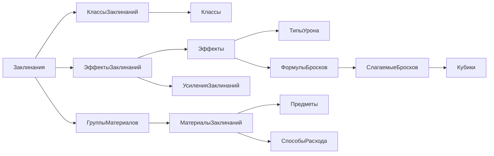

# База заклинаний в Microsoft Access

Версия структуры: 1.0, 2026-10-15. Добавлены четыре демонстрационных заклинания и форма для игрока. Статус: данные и переключение карточки проверены программно; нужна пользовательская проверка содержимого и внешнего вида.

Файл: [База заклинаний.accdb](../База%20заклинаний.accdb).

Предоставленная `dnd database.accdb` использовалась только для знакомства с логикой и не изменялась. Новая база не подключена к приложению, не меняет рабочую SQLite и не переносит ничего на сервер. Пользователь выбрала Access для проверки и последующий перенос в MySQL после согласования.

## Как проверить

1. Открыть `База заклинаний.accdb` в Microsoft Access.
2. При открытии назначена стартовая форма `КаталогЗаклинаний`. Если Access показывает только список объектов, открыть её в разделе «Формы».
3. Выбирать заклинание в списке сверху: Огненный шар, Лечение ран, Опознание или Благословение. Ниже меняются параметры, описание, усиление, эффекты, материалы и доступность классам/подклассам.
4. Посмотреть справочники `ШколыМагии`, `ТипыУрона`, `Кубики`, `ВидыКомпонентов`, `Классы` и `СпособыРасхода`.
5. Для связей открыть **Работа с базами данных → Схема данных → Все связи**. Если окно пусто, добавить таблицы через «Показать таблицу»/«Добавить таблицы»: отношения сохранены в самой базе, заранее разложенный графический макет не создавался.
6. Для подробностей полей открыть таблицу в конструкторе: у полей есть русские подписи и пояснения. Связанные поля в режиме таблицы предлагают выбор по названию, сохраняя числовой ключ.

Карточка доступна только для чтения: она не меняет содержимое таблиц. Внутри использованы три связанные подформы; штатный макрос поиска и обновления привязан к списку выбора. VBA-модулей нет. Технические ключи, статусы проверки и служебные поля игроку не показываются. Таблицы, запросы и инструкция `00_ПрочитайМеня` остаются доступны отдельно.

Это просмотр данных, а не применение заклинания в игре: ресурсы, броски, персонажи и сервер приложения здесь не изменяются.

## Как устроены основные связи



Стрелки показывают путь чтения данных, не направление внешнего ключа. Например, один класс связан со многими заклинаниями, и одно заклинание — с несколькими классами.

### Общие данные для будущих модулей

- **ТипыУрона**: огонь, холод и другие виды. Оружие позже сможет использовать этот же справочник.
- **Кубики**: к4, к6 и другие типы; число кубиков хранится в формуле.
- **ФормулыБросков / СлагаемыеБросков**: несколько кубиков, постоянные числа, модификатор характеристики или бонус мастерства. Например, лечение может состоять из кубика и модификатора заклинателя.
- **Эффекты**: урон, лечение, состояние, изменение показателя, призыв и другие результаты. Ссылка на эффект у заклинания хранит собственные условия применения; будущее оружие получит свою связь.
- **ВыборыЭффектовЗаклинаний / ВариантыЭффектовЗаклинаний**: один вариант может объединять несколько результатов. Например, выбранный вариант щита даёт соответствующий урон и сопротивление вместе; это не выбор одного результата из двух.
- **Предметы**: единый каталог материальных вещей. Отдельный будущий ассортимент торговца будет ссылаться на него, а не копировать названия компонентов.

### Что принадлежит самому заклинанию

Название, уровень (0 — заговор), школа, редакция, ритуал, концентрация, дистанция, длительность, исходное описание, цели, текст компонентов, усиление, ссылка DnD.su и статус проверки.

В отдельных связанных таблицах: классы и подклассы, источники, варианты времени накладывания, В/С/М, материальные требования, эффекты, усиления и области. Списки классов или типов урона не складываются в одну строку через запятую.

### Материалы: особенно важное различие

`Предметы` описывает, **что это за вещь**. `МатериалыЗаклинаний` описывает, **какая вещь нужна именно этому заклинанию**: количество, минимальная стоимость, расход и особые условия.

Цена товара у торговца не равна автоматически минимальной стоимости из требования заклинания. Разные конкретные алмазы позже могут иметь разные параметры; при наполнении торговцев потребуются экземпляры/варианты товара, а не предположение, что любой алмаз подходит.

- Несколько групп материалов нужны вместе.
- Внутри группы «все» нужны все перечисленные требования.
- Внутри группы «один из» достаточно одного варианта.
- Минимум может относиться к отдельному предмету или ко всему набору; эти суммы не смешиваются.
- Способ расхода имеет отдельные варианты: «не проверено», «не расходуется», «расходуется», «частично», «при условии». Незаполненное правило не превращается в бесплатный бесконечный компонент.
- Точный состав и сложные оговорки сохраняются текстом. Возможность заменить материал фокусировкой определяется правилами использования, а не универсальным свойством предмета.

## Что уже заполнено

37 таблиц и 46 связей с контролем ссылочной целостности сохранены. Теперь доступны 10 запросов, одна основная форма с тремя подформами и один штатный макрос.

К исходным справочникам добавлены 97 связанных записей: 4 заклинания, 11 подклассов, источник XGE, классовая доступность, В/С/М, 5 материальных предметов и их требования, 5 формул с 6 слагаемыми, 4 эффекта, 3 правила усиления и сфера Огненного шара. Пустыми остаются таблицы, не относящиеся к этим четырём примерам; выдуманные записи ради их заполнения не создавались.

В справочники включены школы, типы урона, кубики, классы, редакции, В/С/М, характеристики, формы областей, единицы и способы расхода, а также два явно различимых источника 2014 года. Наличие класса в справочнике не означает доступность ему каждого заклинания.

Технические имена для MySQL сохранены в [описании схемы](../database/spells/schema.json). Все пользовательские таблицы и поля Access имеют обычные русские имена. Не используются многозначные поля Access, OLE-вложения или Access-специфичные вычисляемые поля, которые затруднили бы перенос.

## Проверки и ограничения

База создана и перечитана через установленный Microsoft Access Database Engine 16. Сверены таблицы, первичные ключи, индексы и связи; выполнены все сохранённые запросы. Отдельные отрицательные проверки подтверждают запрет потерянных ссылок, уровня вне 0–9, повторов ключей, отрицательной цены/количества и дробных медных монет.

Первоначальная структура проверялась на девяти временных случаях; этот исторический [отчёт структуры](../database/spells/verification.json) относится к базе до наполнения. Теперь четыре примера сохранены в итоговой базе по отдельному запросу пользователя. Описания пересказаны кратко, исходные ссылки DnD.su сохранены у каждой записи; источник — ветка 5e14.

Актуальные проверки: [содержимое связанных записей](../database/spells/demo-data-verification.json) и [форма игрока](../database/spells/player-form-verification.json). В настоящем Access через API проверены открытие формы, выбор всех четырёх заклинаний, повторная смена порядка, обновление подформ, формулы, расход и стоимость материалов, ритуал, концентрация и отсутствие технических полей. По просьбе пользователя проверка выполнялась без кликов и снимков экрана; визуальная приёмка интерфейса не заявляется.

Контроль ссылок и простых значений реализован Access. Полнота и смысл данных — отдельный следующий шаг: хотя бы один источник/вариант времени у завершённой записи, соответствие материальных групп признаку М, согласованность редакций и наличие вариантов у выбираемого типа урона проверяются при заполнении. Их нельзя гарантировать одним внешним ключом. Статус «полностью» не должен выставляться только по наличию записи.

Код заклинания + ревизия уникальны; связанные строки относятся к конкретной ревизии. После утверждения и использования данных изменение механики потребует новой ревизии и сохранения старых ссылок. Общие эффекты/формулы также потребуется копировать при несовместимом изменении, а не переписывать используемую запись на месте. Это каталог для проверки данных, а не реализованный механизм миграции игровых персонажей.

База и форма ещё не приняты пользователем. Не заявляются полнота всего каталога, исполнение игровых правил или интеграция с листом персонажа.

До наполнения сохранена резервная копия в `database/spells/backups`. Предоставленный пользователем файл `dnd database.accdb` и рабочая SQLite приложения не изменялись.

## Файлы и воспроизведение

- [План этапа](./spells-database-plan.md).
- [Словарь всех полей](./spells-database-fields.md).
- [Схема и начальные справочники](../database/spells/schema.json).
- [Определение схемы](../scripts/define-spells-schema.py).
- [Сборка Access](../scripts/build-spells-access.ps1).
- [Проверка на временной копии](../scripts/verify-spells-access.ps1).
- [Четыре примера в структурированном виде](../database/spells/demo-records.json).
- [Подготовка примеров](../scripts/prepare-spell-demo-data.py), [запись в пустой каталог](../scripts/populate-spell-demo.ps1).
- [Создание формы](../scripts/build-spell-player-form.ps1), [проверка данных](../scripts/verify-spell-demo-data.ps1), [проверка формы](../scripts/verify-spell-player-form.ps1).

Создание новой копии из корня проекта, PowerShell:

```powershell
python scripts/define-spells-schema.py
& ./scripts/build-spells-access.ps1 -OutputPath 'D:\project\dnd web\Новая проверочная база.accdb'
& ./scripts/verify-spells-access.ps1 -DatabasePath 'D:\project\dnd web\Новая проверочная база.accdb'
```

Сборщик отказывается перезаписывать существующий файл. Проверяющий скрипт изменяет только собственную временную копию; рабочая база приложения и предоставленный файл пользователя не используются как тестовая база.

Команды выше создают и проверяют **пустую структуру**. Для демонстрационной карточки после этого выполнить `prepare-spell-demo-data.py`, `populate-spell-demo.ps1`, `build-spell-player-form.ps1`, передавая двум последним путь новой копии через `-DatabasePath`. Наполнение отказывается работать с непустым каталогом, а сборщик формы — перезаписывать уже созданную основную форму.
